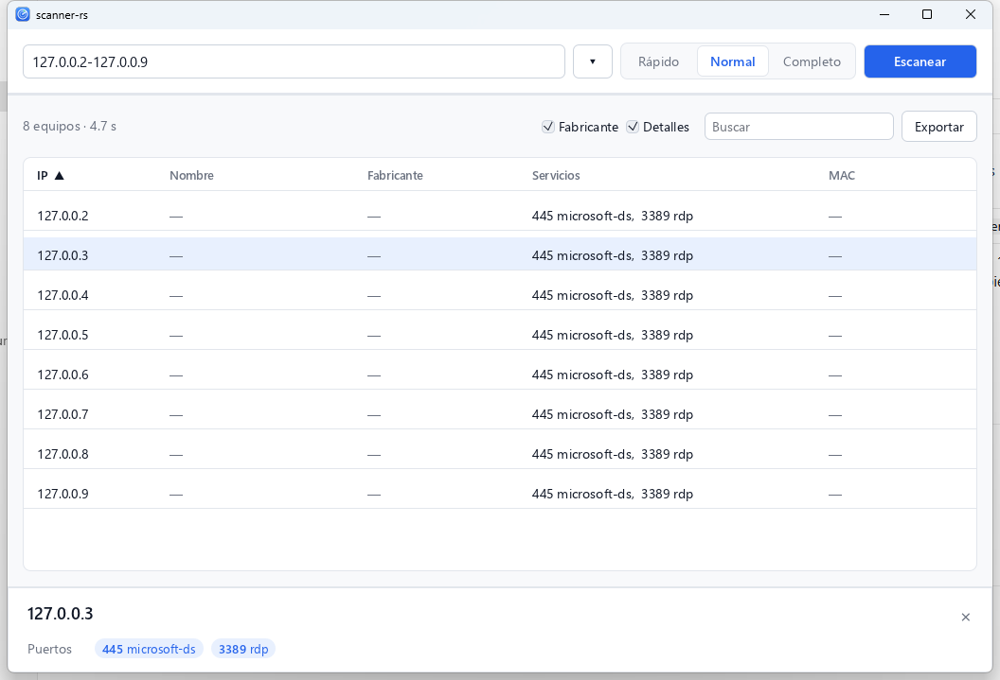

<p align="center">
  <picture>
    <source media="(prefers-color-scheme: dark)" srcset="assets/logo-dark.png">
    
  </picture>
</p>

<p align="center">
  Escáner de red para Windows, rápido y sencillo. Un solo <code>.exe</code>, sin instalación.
</p>

<p align="center">
  <a href="https://github.com/Nestorm18/scanner-rs/releases/latest"><b>Descargar scanner-rs.exe</b></a>
</p>

<p align="center">
  
</p>

## Características

- **Un solo ejecutable**: interfaz gráfica y línea de comandos en el mismo `.exe`.
- **Resultados al momento**: los equipos aparecen en cuanto responden y sus
  servicios se completan después.
- **Detecta tus redes**: el rango de tu red viene puesto; las demás están en **▾**.
- **Puertos y servicios** abiertos, título y servidor web.
- **Fabricante** de cada equipo a partir de su MAC.
- **Ordenar y buscar** por cualquier columna.
- **Exportar** a HTML, CSV (Excel), XML o texto.

## Uso

1. Abre `scanner-rs.exe`.
2. Pulsa **Escanear**. Para otra red o un archivo de IPs usa **▾**, o escribe
   una IP o un rango (`192.168.1.1-192.168.1.254`).
3. Haz clic en un equipo para ver el detalle.

| Modo     | Qué obtiene                                            |
|----------|--------------------------------------------------------|
| Rápido   | Equipos activos, nombre, MAC y fabricante              |
| Normal   | Lo anterior + puertos, servicios y datos web           |
| Completo | Lo anterior + usuarios, recursos compartidos y hora de Windows |

> Escanea solo redes y equipos para los que tengas autorización.

## Línea de comandos

Con argumentos, el mismo ejecutable funciona en la terminal:

```powershell
.\scanner-rs.exe /r:192.168.1.1-192.168.1.254 /v | Out-String
.\scanner-rs.exe /s:targets.txt /v2 /f:resultados.xml
```

| Opción      | Descripción                                               |
|-------------|-----------------------------------------------------------|
| `/r:`       | IPv4 o rango inclusivo                                    |
| `/s:`       | Archivo con una IP o rango por línea (`#` y `;` comentan) |
| `/f:`       | Guarda el resultado; `.xml` selecciona formato XML        |
| `/v`        | Servicios y metadatos HTTP                                |
| `/v2`       | Añade usuarios, recursos compartidos y hora de Windows    |

`| Out-String` hace que PowerShell espere a que termine el escaneo antes de
mostrar el prompt.

## Cómo funciona

- **Descubrimiento**: ping ICMP, ARP (en redes locales) y conexión a puertos
  habituales, en paralelo.
- **Servicios**: conexión TCP a cada puerto conocido y, si existe un archivo
  `service_probes` junto al ejecutable, identificación por firmas.
- **Fabricante**: los 3 primeros bytes de la MAC (OUI) se buscan en el registro
  del IEEE incluido en el ejecutable. Las MAC aleatorias se marcan como tales.

## Compilar

Requiere Rust estable y las herramientas de compilación de Visual Studio (MSVC).

```powershell
cargo build --release
```

Genera `target\release\scanner-rs.exe` con el icono incrustado.

```powershell
cargo test
cargo fmt --check
```

- El icono se dibuja por código en `src/icon.rs`. `cargo run --example export_icon`
  regenera `assets/icon.ico` y `assets/icon.png`.
- `assets/oui.txt.gz` contiene el registro OUI del IEEE, tomado del archivo
  [`manuf`](https://www.wireshark.org/download/automated/data/manuf) de Wireshark.

## Licencia

[MIT](LICENSE)
